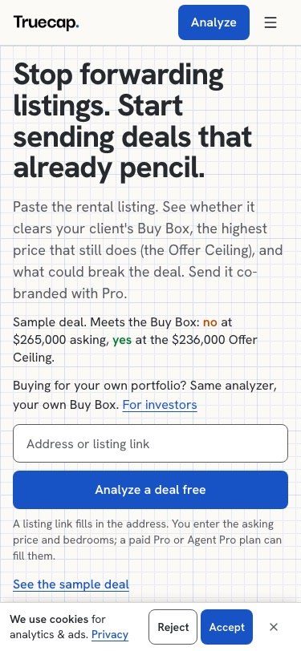
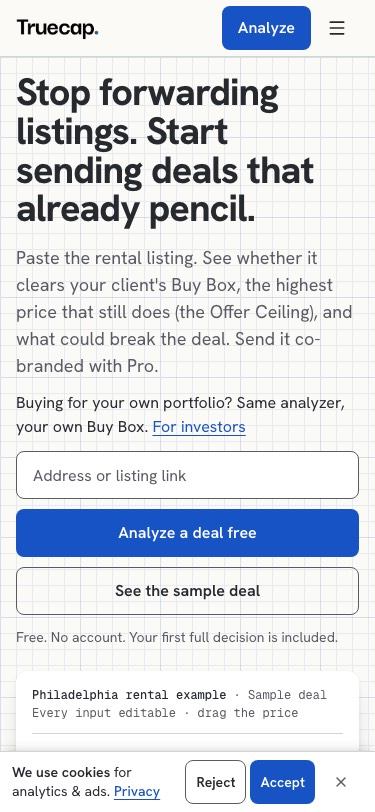
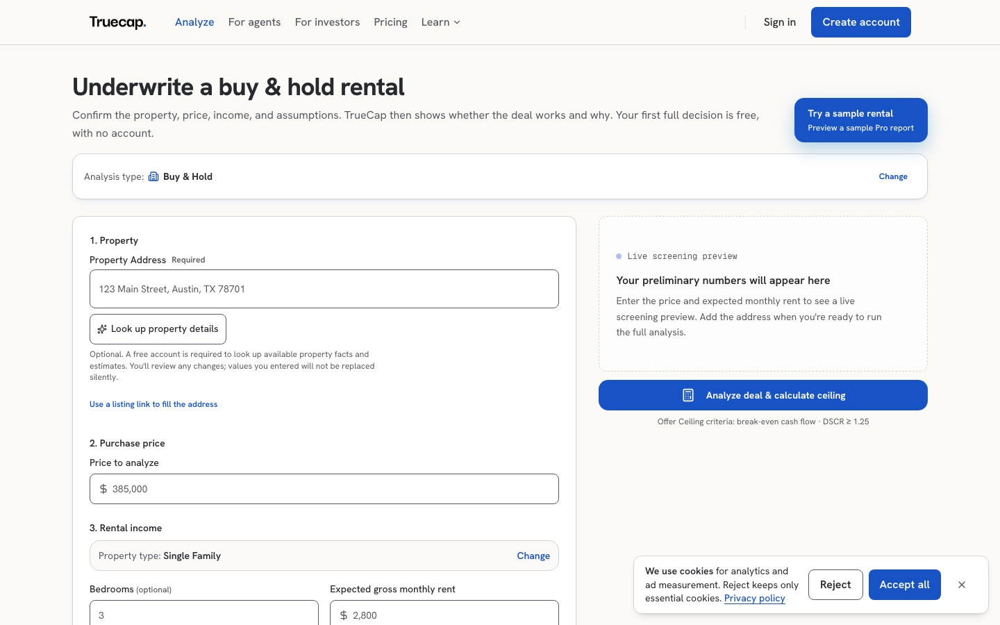
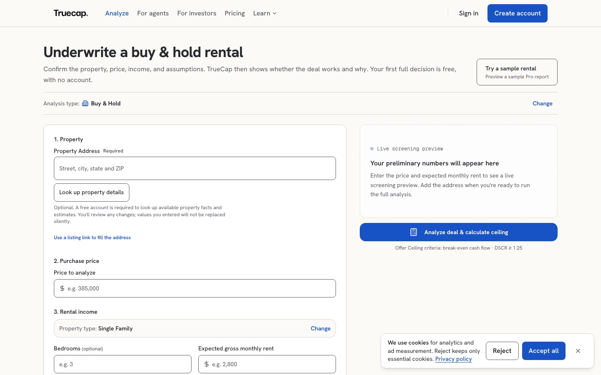
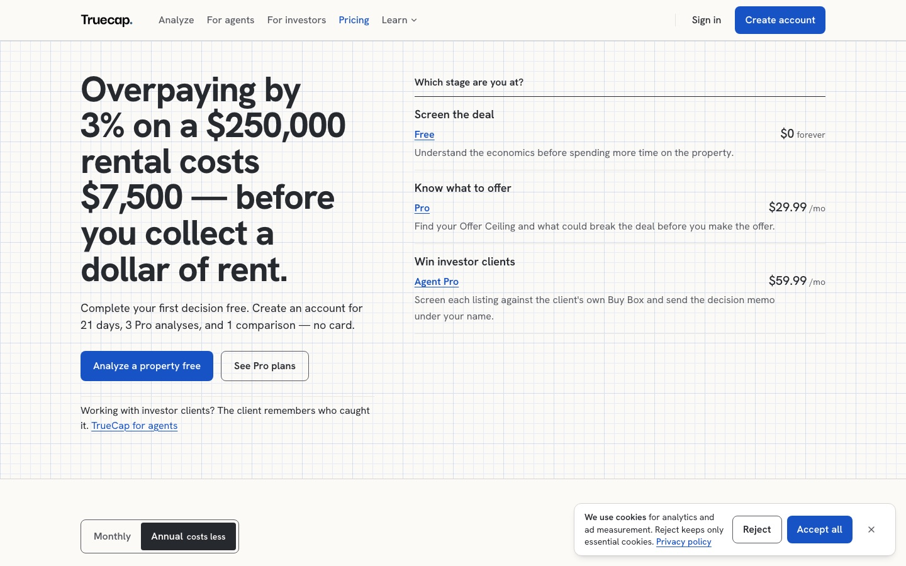
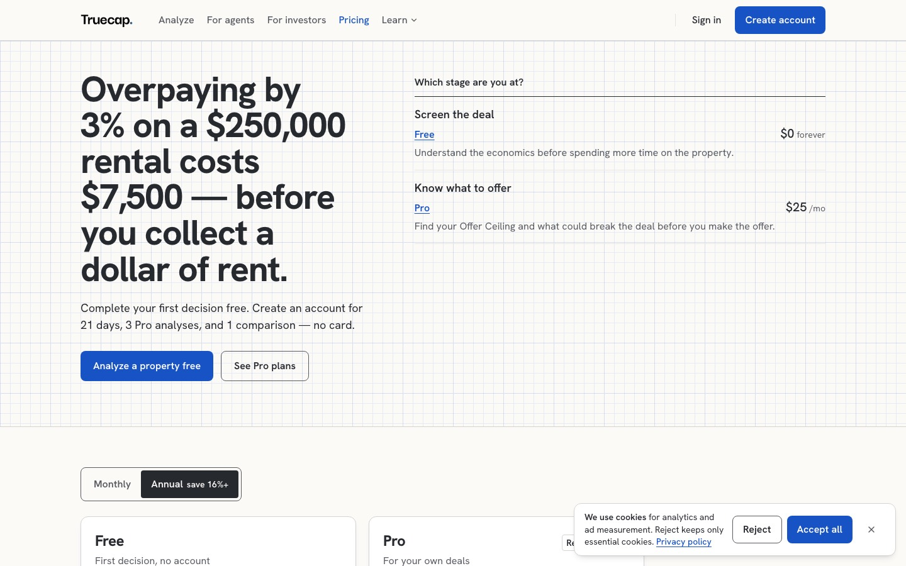
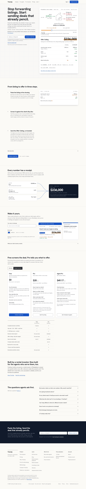
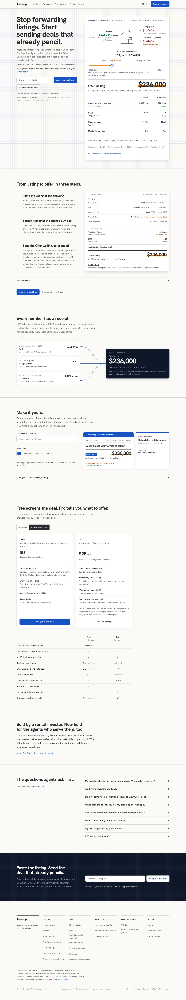

# Trust and timing pass (2026-10-21): after the adversarial audit

An adversarial audit of the live site (`../adversarial-audit/audit.md`, its
evidence and scripts on this branch) found 26 issues, A1 to A26. The pass
fixes what it could within the guardrails: the founder answered the audit's
six questions with the recommended options before any of them was touched.
This branch is `design/trust-pass-2026-10`, one commit per surface.

## The founder's answers (2026-10-21)

| Question | Answer |
|---|---|
| Q1 The signed-in home on the deal list | Yes in principle; a separate PR after this one (needs an account to verify). Not in this pass. |
| Q2 /pricing presentation (§8) | The stage list follows the toggle; the toggle names the saving from the catalog; Agent Pro annual reads "$590/yr". |
| Q3 The phone hero | The price track and the Offer Ceiling directly under the form, the helper line below the sheet; "See the sample deal" as the secondary button. |
| Q4 When no target binds | "No price limit under these targets" past 2x asking. |
| Q5 The sample's rate | Keep the fixture and date it. |
| Q6 Sentry | The browser SDK starts after the first input; sample rates and `ignoreErrors` unchanged. |

## What changed, per finding

| # | Finding | Fix | Commit |
|---|---|---|---|
| A1 | The sample's receipts contradicted each other: "HUD FMR" and "FRED rate" in the hero, "Your entered rent" and "Your rate estimate" in the analyzer, the rate undated | `SAMPLE_DEAL_FIXTURE.provenance` (`lib/sample-deal.ts`): one tag, basis and replacement per input, read by the hero's chips, the receipts, the story, the memo and the analyzer's input tags (a display-only relabel in `buildInputConfidence`: classes, points and stage unchanged). Two corrections to the audit's proposal, from the sources: the $3,050 rent is the example's own figure, not HUD's (the repo's SAFMR row for 19140 three-bedroom is $1,660), so it reads "Sample input, 25 Aug 2026"; FRED's MORTGAGE30US (Freddie Mac PMMS) has 6.65% for the week of 20 Aug 2026 and nothing for 25 Aug, so the rate reads "FRED, 20 Aug 2026" and its popover says it is rounded to 6.6% and is not today's rate | `b41968c5`, `d7e283a3` |
| A2 | `/analyze?sample=1` showed seconds of empty form | The sample's decision card, server-rendered from `calculateSampleDealOutcome()` and hidden by default; a head script sets `data-sample` before first paint (a layout effect does it on a client-side navigation); CSS swaps it for the live card in one paint once the live card has settled; the live card skips its entrance over it and takes the focus if the analyzer's hand-off has given up | `7da727b9` |
| A3 | The hero's glide misfired: replayed after the answer showed, never played on short phones, moved the handle by itself after an early drag | The handle never moves by itself; the moment is a draw of the meets-range out to the asking marker and back (scale only), observed on the 44px track, skipped when hydration lands more than 1 s after first paint or a pointer touched the sheet first | `d6e1d6fd` |
| A4 | The font swap shifted the live layout (CLS 0.181 on /, 0.230 on /pricing): next/font's fallback is `local("Arial")`, absent on Android and most Linux | Four metric-matched fallback faces for Roboto and Liberation Sans, computed by `scripts/font-fallback-metrics.mjs` with next/font's own formula (its Arial numbers reproduce exactly), listed after next/font's fallback in the three family stacks | `8294be1f`, `f5f19e81` |
| A5 | The lookup swapped the rate under the preview, noted only in a toast | A line under the preview's cash flow, "Rate updated to FRED 7.40% (Oct 15) from the 6.75% default", with Undo and a dismiss; fills of empty fields keep the toast | `0c1faf80` |
| A6 | A typed $0 rent became HUD's figure | `isRentAutofillable`: empty from the dirty state, not the value (test first) | `e7f00b17` |
| A7 | A cash purchase showed a $1,296,500 ceiling on a $250,000 house | Past 2x asking: "No price limit under these targets", no key figure, no track, no ceiling in the summary bar; the engine is untouched | `e30dc779` |
| A8 | Ten text blocks before the instrument at 390 | Below 1024px the hero column joins the grid: the sheet (track and Offer Ceiling first) follows the form, the listing helper line follows the sheet, the phone verdict sentence is gone; "See the sample deal" is the secondary button | `b57f43c6` |
| A9 | The sample's address field read "TrueCap Synthetic Sample, …" | The field shows the sample's display label over its sentinel value (display only) | `6a0a7c4c` |
| A10 | Placeholders read as answers | "e.g." hints throughout the core form; the address field's hint is a format, not an Austin address | `620df15d` |
| A11 | Off the system: sparkles, a floating sample button, mono figures, a card for one setting | No sparkle in `components/investcalc/`; the sample button is the secondary control; the assumption chips in the text face with tabular figures, the source tag in Geist Mono at 12px; the analysis type is a row | `6a0a7c4c` |
| A12 | The card said ceiling, gap and asking three times and stacked three callouts | The track's dimension labels carry them once (the gap beside the label below 640px); the next step, the fastest path and what to verify are one block on the cobalt rule; the Deal score reads "Base economics at asking, 0–100" beside a miss; Mark verified is a quiet row action | `e30dc779` |
| A13 | /pricing said $29.99 beside $25 cards | The stage list follows the toggle; the toggle names "save 16%+", the floor both plans meet from their catalog prices; an annual price with cents per month shows as the annual charge ("$590/yr") on the homepage, /pricing and /for-agents | `a24c10ef` |
| A14 | The sticky bar floated over plan cards | Docked full width from 1024px with `shadow-float-up`; it stands down while the hero, the plans or the close is on screen | `057fcf2c` |
| A15 | The preview applied its own "Solid bar" | `lib/limiting-factor.ts` phrasing without the internal tier, and a line naming the run's targets | `620df15d` |
| A16 | The story crossfaded three frames | One pinned sheet that accumulates (see "Not done as written") | `d7e283a3` |
| A17 | The cookie banner's controls came before the skip link | The banner renders right after the skip link and no longer takes focus | `057fcf2c` |
| A18 | `/analyze` without JavaScript | A `<noscript>` line pointing to `/sample-decision-memo`; the header server-renders its links | `7da727b9`, `bcc77c71` |
| A19 | The next `/analyze` reopened the last run and still promised a free decision | A fresh navigation does not reopen exactly the last finished run (a reload or Back does); the intro says the free decision is used once it is | `bcc77c71` |
| A20 | Sentry cost about 400 ms of script on every route | The SDK starts on the first input, or on the next idle moment once an error is buffered; the manifest bump is its own commit | `ecc432e7`, `fe4f034d` |
| A22 | Sign in and Create account appeared only after hydration | `/analyze` sets the header's `anonymousByDefault` | `bcc77c71` |
| A24 | Live figures exposed as images | An sr-only text twin; the animated host hidden from assistive tech | `b34d57be` |
| A25 | A Redfin link parsed with the ZIP mid-street | Street, city, state, ZIP (test first) | `054e4d73` |
| A26 | "after reserve" and "after reserves" | The card says "after reserves", as the site does | `e6d8a259` |

## Not done as written, and why

- **A16 as a CSS `view()` timeline.** The P1-73 truth guard
  (`lib/__tests__/reference-content-truth-guards.test.tsx`) forbids content
  opacity tied to scroll position, and truth pins never move. The sheet uses
  the receipt leaders' pattern instead: a step's rows enter once when the step
  is reached, armed only while the story is below the fold at hydration,
  never under reduced motion, complete without JavaScript.
- **A1's suggested label "FRED, 25 Aug 2026".** No FRED observation exists for
  that date and the fixture's 6.6% is a rounding of 6.65%; the label says so.
- **A9 for the share title.** The share dialog's title expression is pinned by
  a privacy test (`client-report-address-choice`); a sample shared with its
  address shown still carries the sentinel there.
- **A26 for "Model DSCR".** It is the methodology's term for the model's DSCR
  as opposed to a lender's, pinned across the result's unit and e2e tests.
  One presentation phrase, "Positive before tax and after reserve", is pinned
  and stays.
- **A21 and A23** (/pricing rendered per request; the cookie banner arriving
  at about 9 s on slow 4G): outside the fixes the prompt ordered and not
  reached.
- **Q1** (the signed-in home): a separate PR, by the founder's answer.
- **Safari and real phones** are still unexercised by automation, as in the
  audit. The A4 check (Lighthouse on Linux without Arial) could not run here:
  this Mac has Arial. The fallback numbers are next/font's formula, checked
  against next/font's own output.

## Verification

Everything below ran on this branch's production build with the
`scripts/dev-isolated.sh` environment, served on 127.0.0.1:3100, on the
founder's Mac. The polish pass's rows are from the same Mac; the audit's
local and live rows came from a slower cloud host, so compare within a
source.

| Gate | Result |
|---|---|
| `npx tsc --noEmit`, `npm run lint` | clean; lint has 0 errors and 3 warnings, all in the audit's own committed scripts (`adversarial-audit/tools/flows-a`, `flows-b`, `sample-network`), left as the audit wrote them |
| `npm test` | 536 files, 9,221 tests passed, 2 skipped (none added or skipped by this branch) |
| `npm run build` (isolated environment) | exit 0 |
| Playwright `public-chromium` | 50 passed, 10 skipped (the autofill spec, which needs the mock); the autofill spec against a server on the loopback enrichment mock (`AUDIT_ENRICHMENT_MOCK=1`): 10 passed, including the new A5 test. The first full run found three failures; two were fixed (the conversion bar's stand-down scoped to 1024px; the tablet run bar flapping at 600px, latent on main), the third was the mock's rent fill racing a typed value in a test written for a server without lookup keys, and passes on that server |
| Build-chain integrity | `instrumentation-client.ts` changed (A20); the manifest bump is its own commit (`fe4f034d`); `verify-build-integrity.mjs` passes |
| Detector, source (`impeccable detect --json`, 42 changed UI files) | no primary findings; `app/globals.css` has main's three advisories |
| Detector, rendered (1440×900 / 390×844; limits 17/17, 4/2, 26/13, 1/1) | `/` 14 / 16 · `/analyze` 4 / 2 · `/analyze?sample=1` 23 / 12 · `/pricing` 1 / 1 |
| Keyboard (`tools/qa-keyboard.mjs`) | 12 of 12 (the script now picks the visible "How this ceiling was calculated": the sample's hidden static card carries the same summary) |
| Keyboard order (audit `keyboard.mjs`) | stop 0 is "Skip to main content", then the consent controls (the audit had the banner's four controls first) |
| Reduced motion (`tools/qa-reduced-motion.mjs`) | the hero rests at 236,000; the leaders drawn; no reveal plays |
| Without JavaScript (`tools/qa-no-js.mjs`) | complete at 390 and 1440: the thumb at 236,000, three receipt nodes, nothing at opacity 0, no overflow; 1,275 words at 390 |
| Slow 4G at 390 (`tools/qa-slow-4g.mjs`) | first paint 0.86 to 0.90 s; the address field visible at 0.94 s |

### Per finding

| Check (from the prompt) | Result |
|---|---|
| A1: `/`, `/analyze?sample=1`, `/sample-decision-memo` show the same rent and rate lines; nothing on the sample reads "Your entered rent" or "Your rate estimate" | holds on all three (`tools/sample-labels.mjs`); no "Synthetic" on the sample either |
| A2: `sample-flash iphone slow4g` finds no frame with the form and no card; CLS ≤ 0.05 | no form-only frame: the static card from first paint (1.1 s) until the live card (6.1 s), desktop 0.16 to 0.81 s; the swap moves the card's parts by 0 px at 390, 1095 and 1440, CLS 0, 0.0001, 0; focus lands on `#decision-summary-title` (`tools/sample-swap.mjs`) |
| A3: the moment plays on load at 1095×760 and 1280×720, no `aria-valuenow` above the ceiling before a drag; an early drag moves nothing; reduced motion rests at 236,000 | plays on load from 390×844 up (on scroll at 375×667); `aria-valuenow` never leaves 236,000; an early drag at 1.1 s on throttled iPhone, then nothing moves |
| A4: Lighthouse on Linux without Arial, CLS ≤ 0.05 | not runnable here (this Mac has Arial); local CLS 0.000 / 0.000 / 0.002; the faces' numbers are next/font's formula, checked against next/font's own Arial output |
| A5: the line appears, Undo restores 6.75 | e2e passes behind the mock |
| A6: `zero-rent` keeps "0" after 3 s and after Run | with a lookup that really answers (`tools/zero-rent-mock.mjs`, the HUD request reached the mock): "0", "0" |
| A7: `break-analyzer desktop cash-purchase` shows no seven-digit ceiling | "No price limit under these targets", no track, no seven-digit figure |
| A8: blocks before the instrument at 390 | 7 (was 10), the CTA and the sample button among them; the track at 759 px (was 1,285) and the Offer Ceiling's label at 891 px (was 1,417) on 390×844 |
| A12: the card at least 15% shorter at 390; focus on the verdict; the 390×844 fold | 974 px against main's 1,189 (18%), 905 against 1,012 at 1440; focus on `#decision-summary-title`; the actions end at 814 px (main 838) and the fold spec passes |
| A13: the stage list follows the toggle | annual by default ("$25 /mo"), monthly with the toggle; the toggle reads "Annual save 16%+" |
| A14: no frame with the bar over a plan card | 0 of 40 scroll stops at 1440 and 1095; docked full width whenever shown (`tools/bar-overlap.mjs`) |
| A16: one sheet with nothing at opacity 0 without JavaScript; the section 25% shorter at 1440 | rows [1,0,0] → [1,1,0] → [1,1,1] as the steps pass, all visible at rest and without JavaScript; the section 1,066 px against 1,462 (27% shorter) |
| A17: the skip link at stop 0 | yes |

### Lighthouse CI (mobile, 390×844, simulated throttling, medians of 3 runs)

| Route | Perf | A11y | LCP | TBT | CLS | Script KB |
|---|---|---|---|---|---|---|
| `/` polish | 0.87 | 1.00 | 3.7 s | 152 ms | 0.000 | 430 |
| `/` trust pass | 0.88 | 1.00 | 3.7 s | 35 ms | 0.000 | 350 |
| `/analyze` polish | 0.88 | 1.00 | 3.5 s | 181 ms | 0.002 | 631 |
| `/analyze` trust pass | 0.89 | 1.00 | 3.6 s | 90 ms | 0.000 | 569 |
| `/pricing` polish | 0.94 | 1.00 | 3.0 s | 42 ms | 0.002 | 445 |
| `/pricing` trust pass | 0.93 | 1.00 | 3.3 s | 16 ms | 0.002 | 357 |

`lhci assert` exits 0 with the polish pass's three warnings (`/` LCP,
`/analyze` LCP, `/` script weight) and no error (`lighthouse/assert.log`).
Script weight fell by 62 to 88 KB per route and blocking time by 26 to
117 ms: the Sentry SDK no longer loads in a session with no input (A20).
The script figures moved more than "within a few KB" of the baseline, all
downward.

### Homepage transfer (`npm run perf:homepage`)

| Measure | Polish | Trust pass | Budget |
|---|---|---|---|
| HTML (identity encoding) | 282,435 B | 278,580 B | 350 KB |
| First-party JavaScript | 438,620 B over 40 | 347,943 B over 36 | 1 MB |
| LCP (lab, unthrottled) | 164 ms | 168 ms | 2,500 ms |
| CLS | 0.0001 | 0.0002 | 0.1 |
| Long tasks | 0 | 0 | 500 ms |
| Main-thread task time | — | 457 ms | — |
| axe serious or critical | 0 | 0 | 0 |

`budgetFailures` is empty. The script exits 1 on its analyzer-ready probe,
which waits 15 s for `data-calculator-ready` on a homepage that no longer
renders the analyzer; the audit recorded the same timeout on main.

## Before and after

Before is the polish pass's capture of main (`../polish/after/`), after is
this branch (`after/`), both from the local production build.

| Surface | Before | After |
|---|---|---|
| The phone hero, 375 (A8) |  |  |
| The sample at 375 (A2, A9, A12) |  |  |
| The sample at 1440 |  |  |
| The analyzer at 1440 (A10, A11) |  |  |
| /pricing at 1440 (A13) |  |  |
| The homepage, whole page, 1440 (A14, A16) |  |  |

The sample's static card and its live card, side by side for the swap:
`shots/sample-static-{390,1095,1440}.jpg` and `shots/sample-live-*.jpg`.
The story at rest: `shots/story-1440-rest.jpg`.

## For the founder

- **The sample's rent.** The fixture's $3,050 a month for a three-bedroom in
  19140 is well above the HUD benchmark the analyzer would fill for that ZIP
  (the repo's SAFMR example row reads $1,660; the current FY2026 figure was
  not looked up). The sample now says its rent is the example's own, not
  HUD's, which is true; whether the example should use a rent nearer the
  benchmark is a fixture decision (Q5's territory: every sample figure and
  its regression snapshot would move).
- **The signed-in home (Q1)** is the next PR.
- **A21 and A23** remain open (see above).

## Captures and tools

`after/`: `/`, `/analyze`, `/analyze?sample=1` and `/pricing` at 375, 768,
1095 and 1440, first screen and full page, with `facts.json`. `keyboard/`,
`no-js/`, `reduced-motion/`, `slow-4g/`, `detector/`, `lighthouse/`,
`perf-homepage.json`: each check's output, as in the polish pass.
`instruments/` and `shots/` hold this pass's measurements and frames
(the audit's scripts rerun with `BASE=http://127.0.0.1:3100` and
`AUDIT_EVIDENCE`/`AUDIT_SHOTS` pointed here). `tools/` holds the scripts
written for this pass: `sample-swap.mjs`, `story-sheet.mjs`,
`bar-overlap.mjs`, `card-height.mjs` (compares a branch build with a main
build), `sample-labels.mjs` and `zero-rent-mock.mjs`. Two audit scripts gained
a column for the new behaviour (`glide-check.mjs` reads `data-glide`;
`sample-flash.mjs` counts the static card as a card), and
`docs/overhaul-2026-10/tools/qa-keyboard.mjs` picks the visible ceiling
disclosure.
